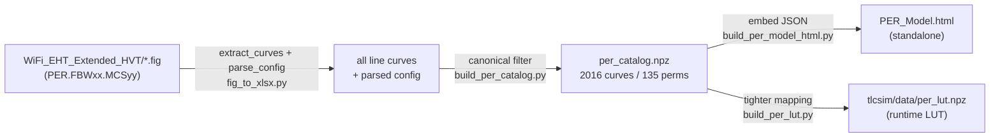

# PER Model — how it is built from `WiFi_EHT_Extended_HVT`

This document explains how the standalone [PER_Model.html](PER_Model.html) PER
(Packet Error Rate) model is produced from the raw MATLAB link-level simulation
figures under
[`WiFi_EHT_Extended_HVT/`](WiFi_EHT_Extended_HVT/WiFi_EHT_Extended_HVT).

The model is purely **measured data** — no analytic/curve-fit approximation.
Every PER-vs-SNR curve shown is a real simulated sweep, resampled and looked up
at runtime.

---

## 1. The raw source: the `.fig` set

`WiFi_EHT_Extended_HVT/WiFi_EHT_Extended_HVT/` contains MATLAB figure files from
the EHT link-level simulator. They are named by **metric · scenario · frame
bandwidth · MCS**, for example:

```
PER.WiFi_EHT_Extended_HVT.FBW80.MCS7.fig
BER.WiFi_EHT_Extended_HVT.FBW160.MCS3.fig
EVM.WiFi_EHT_Extended_HVT.FBW20.MCS0.fig
Time.WiFi_EHT_Extended_HVT.FBW320.MCS9.fig
Memory.WiFi_EHT_Extended_HVT.FBW40.MCS5.fig
```

Metrics present: `PER`, `BER`, `EVM`, `Time`, `Memory`. **Only the `PER.*` figs
drive this model.**

Each `.fig` is a MATLAB HG (Handle Graphics) struct saved as a `.mat` file. A
single `PER.*.fig` holds **many** `Line` objects — one per tested configuration.
Each line's `DisplayName` encodes the full config as a TeX string, e.g.:

```
PER: EHT SU 80/80 MHz 1x1 N_S 1, 0.8us LTF & x 2, LDPC ..., PPM 0,
     RUsize 242 RUindex 1, ..., SNR_10^-1 = 12.4
```

and its `XData`/`YData` are the SNR (dB) sweep and the corresponding PER.

---

## 2. Extraction — reading curves out of the `.fig`

Script: [`fig_to_xlsx.py`](fig_to_xlsx.py) (the shared extraction layer, also
used by the catalog builder).

1. `extract_curves()` loads the `.fig` with `scipy.io.loadmat`, walks the HG tree
   (via helpers in `fig_viewer.py`), and collects every `line` /
   `graph2d.lineseries` node as `{name, XData, YData}`.
2. `clean_name()` converts the MATLAB TeX `DisplayName` into plain readable text
   (`\times` → `x`, strips `${...}`, collapses whitespace/commas, etc.).
3. `parse_config()` regex-parses that clean name into structured fields:
   Format, SU/MU, FrameBW, ChannelBW, Antenna (`1x1`/`1x2`/`2x2`), Nss,
   `GI [us]`, LTF, LDPC, Length, PPM, RUsize, RUindex, the sensitivity
   `SNR_sens [dB]`, and the target.

The sensitivity annotation `SNR_10^-k = <dB>` is parsed separately to recover the
**SNR at the k-decade PER target** (e.g. `SNR_10^-1` = SNR at 10% PER).

---

## 3. Canonical curve selection — collapsing to one curve per operating point

Script: [`build_per_catalog.py`](build_per_catalog.py).

A `PER.*.fig` contains many variants of the same rate (different packet lengths,
control modes, PPM, RU indices, …). The catalog keeps a single **canonical**
curve per physical operating point using these rules:

| Filter | Kept value | Why |
|--------|-----------|-----|
| `DisplayName` prefix | `PER:` only | excludes `DPER`/`HPER` derived variants |
| `PPM` | `0` | no residual frequency offset (clean AWGN reference) |
| `RUindex` | `1` | first resource unit |
| Coding / channel | LDPC, AWGN, SU | the only values present in this set |
| Duplicate length sweeps | **longest sweep** | widest SNR coverage wins |

The operating point key is:

```
frameBW , channelBW , antenna , GI , MCS
```

`frameBW` comes from the file name (`FBWxx`); `channelBW`, `antenna`, and `GI`
come from the parsed `DisplayName`. The X (SNR) axis is sorted ascending and PER
is clipped to `[0, 1]`.

The output is [`per_catalog.npz`](per_catalog.npz):

- `keys` — the `"fbw,chbw,ant,gi,mcs"` strings
- `x{i}` / `y{i}` — sorted SNR (dB) and PER for curve `i`
- `snr_sens` — SNR at the sensitivity target per curve
- `per_target` — the PER target (e.g. 0.1) per curve

Result for this data set: **2016 canonical curves** spanning **135 permutations**
(frame BW × channel BW × antenna × guard interval), each with up to MCS 0–15.

> A parallel builder, [`build_per_lut.py`](build_per_lut.py), produces the
> compact runtime LUT `../tlcsim/data/per_lut.npz` used by the Python TLC
> simulator. It applies the same canonical-selection idea but a tighter
> antenna/GI mapping (SISO → `1x2`, MIMO → `2x2`; `0.8µs`↔`2xLTF`,
> `3.2µs`↔`4xLTF`). The catalog here is the *superset*: all measured
> permutations, for exploration.

---

## 4. Standalone HTML — embedding the catalog

Script: [`build_per_model_html.py`](build_per_model_html.py).

1. Loads `per_catalog.npz` and serializes each curve to compact JSON
   `{"s": [snr…], "p": [per…]}` keyed by `"fbw,chbw,ant,gi,mcs"`.
2. Inlines that JSON directly into `PER_Model.html` as the `PER_CAT` constant, so
   the file has **no external dependencies** — open it directly in any browser.

At runtime the page provides:

- **Selectors** for frame BW, channel BW (≥ frame BW), antenna, guard interval.
- **`perLookup()`** — linear interpolation of PER between measured SNR points
  (below the swept range → PER 1, above → PER 0, below a 0.1% floor → 0).
- **`snrAtPer()`** — inverse lookup: SNR needed for a given PER target
  (10% / 50%), used for the sensitivity table and the on-curve MCS labels.
- A **sensitivity CSV export** of SNR@10% PER for all permutations.

To rebuild the standalone model from scratch:

```bash
# from the TLC_Sim repo root
python PERModel/build_per_catalog.py       # .fig set -> per_catalog.npz
python PERModel/build_per_model_html.py    # per_catalog.npz -> PER_Model.html
```

---

## 5. Pipeline at a glance



---

## 6. What "canonical PER" means here

All curves in the model share the same reference conditions so they are directly
comparable:

- **AWGN** channel, **LDPC** coding, **SU** (single user)
- **PPM 0** (no frequency offset), **RUindex 1**
- PER read from the measured sweep; interpolated between points, saturated
  outside the swept SNR range, and treated as 0 below a 0.1% floor.

This makes the model a clean, measured **PER-vs-SNR reference** across the full
EHT frame-BW / channel-BW / antenna / guard-interval space.
