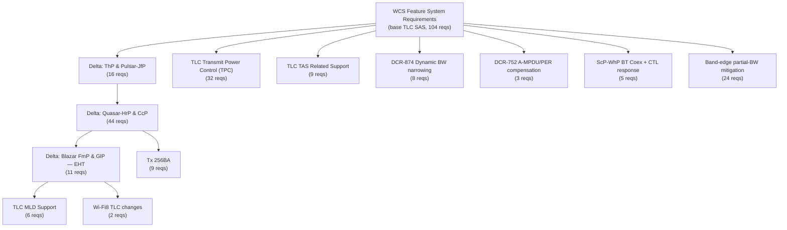

# TLC SAS Requirements — Summary (JIRA R4J folder 4251)

Condensed digest of the **Tx Link Control (TLC)** requirement tree in Intel JIRA.

| | |
|---|---|
| **R4J path** | `WCS Requirements / WiFi / Feature Requirements (SAS) / Link Control / Tx Link Control (TLC)` |
| **Root folder ID** | `4251` (parent `4240` Link Control → `3484` Feature Requirements (SAS) → `3473` WiFi) |
| **Browse** | https://jira.idoc.intel.com/plugins/servlet/com.easesolutions.jira.plugins.requirements/project?detail=WREQ&folderId=4251 |
| **Contents** | 546 issues — 281 `Requirement`, 264 `Text` (section headers), 1 `Change Request` |
| **Status mix** | 275 Requested · 264 Open · 4 Obsolete · 2 Deferred · 1 Approved |
| **Snapshot** | 2026-09-22 |

Companion files:
- [TLC_SAS_WREQ_Index.md](TLC_SAS_WREQ_Index.md) — full 281-row WREQ index with links.
- [TLC_Hierarchy.md](TLC_Hierarchy.md) — code/architecture view of the same feature.
- [PERModel/PER_Model.md](PERModel/PER_Model.md) — measured PER curves backing the TvA requirements.

> Requirement text below is paraphrased. The WREQ link is always authoritative.

---

## 1. Document map

The folder is not one SAS — it is a **base SAS plus a stack of per-silicon delta SASs**
plus feature-specific DCR sub-trees.



| Document | Reqs | Scope |
|---|---:|---|
| WCS Feature System Requirements | 104 | Base TLC SAS: FSM, statistics, retry table, protection, backoff, LQ/TX-response API, validation |
| TLC SAS — Quasar-HrP & CcP (Delta) | 44 | 802.11ax/HE, TLC Offload to UMAC CPU2, Tx A-MSDU control, scheduled mode |
| TLC SAS — ThP & Pulsar-JfP (Delta) | 16 | Dynamic channel width, rate-upscale test windows, Tx A-MSDU introduction, rate DB |
| TLC SAS — Blazar FmP & GlP (Delta) | 11 | 802.11be / EHT: 320 MHz, puncturing, 1024 BA, extra LTF, EHT TAS |
| TLC Transmit Power Control (TPC) | 32 | TPC 2024 + TPC 2025 rewrite + DCR-3413 (DFS/VLP, non-data packets) |
| TLC TAS Related Support | 9 | Time-Average-SAR ↔ TLC signalling (`DisconnectMargin`, `TAS_PBO`) |
| TLC MLD Support | 6 | Per-link rate control, MLD BA agreements, MLD A-MSDU sizing |
| Tx 256BA | 9 | 256-frame Block-ACK budget, A-MPDU frame-count limits, SR EWMA/aging |
| DCR-874 Dynamic BW narrowing | 8 | `txNetTimeFactor` airtime gauges, non-adjacent BW exploration |
| DCR-752 A-MPDU/PER compensation | 3 | SR aggregation-count factor, test-window size, exploration blackout |
| ScP-WhP TLC Update + CTL response | 5 | BT-coex asymmetric antenna selection, control-frame antenna choice |
| Band-edge partial-BW mitigation | 24 | Reassociate to 20 MHz on band-edge channels (driver-level, SfP/WsP) |
| Control frame rate and antenna selection | 2 | LQ control-frame rate field, RTS during exploration |
| Wi-Fi8 TLC changes | 2 | 11bn finer MCS set, NPCA agnosticism |
| TEMP (WiFi Docking PoC) | 5 | DCR-379 low-power docking Tx limits |

---

## 2. Core algorithm requirements (base SAS)

### 2.1 State machine

Two states only: **Stay in Column** ↔ **Search Cycle**.

| Aspect | Requirement | WREQ |
|---|---|---|
| Initialization triggers | Association, re-association, channel switch, AP-commanded BW change | [WREQ-34880](https://jira.idoc.intel.com/browse/WREQ-34880) |
| Initial state | Always **Stay in Column** | [WREQ-34881](https://jira.idoc.intel.com/browse/WREQ-34881) |
| Initial rate | Always a **legacy** rate, chosen from last-beacon RSSI + association caps; no beacon info → mid-range (11b 5.5, 11g/n 18, 11ac 24). Initial antenna = best-RSSI antenna | [WREQ-34882](https://jira.idoc.intel.com/browse/WREQ-34882) |
| SiC → SC triggers (OR) | PPDU/MPDU success or failure counters over threshold; `RS_Stay_in_Column_Timer` elapsed; lowest rate in column ineffectual (SR ≤ downscale th, a lower column exists) | [WREQ-34896](https://jira.idoc.intel.com/browse/WREQ-34896) |
| SiC → SC when idle | No TX for `RS_Stay_in_Column_Timer` → revert to initial rate/antenna | [WREQ-34897](https://jira.idoc.intel.com/browse/WREQ-34897) |
| Search Cycle operation | **Stage 1** rate selection (compare MCS, MCS+1, MCS−1 by TpT); **Stage 2** column selection — legacy: chain A/B → HT NSS → BW → GI | [WREQ-36755](https://jira.idoc.intel.com/browse/WREQ-36755) |
| Column-change ordering | Each successful test window in a new column must first converge on the optimal rate **in that column** before trying another column | [WREQ-34899](https://jira.idoc.intel.com/browse/WREQ-34899) |
| Test-window optimization | Skip a column if it has no TpT-improvement potential, or statistics already exist | [WREQ-34900](https://jira.idoc.intel.com/browse/WREQ-34900) |
| SC → SiC | Negative of the SC entry criteria (all relevant configurations examined) | [WREQ-34902](https://jira.idoc.intel.com/browse/WREQ-34902) |
| Counter reset on SC → SiC | Clears PPDU/MPDU success+failure counters and the initial-rate ACK/BA consecutive-failure counters | [WREQ-34903](https://jira.idoc.intel.com/browse/WREQ-34903) |

### 2.2 Statistics and Success Ratio

| Topic | Requirement | WREQ |
|---|---|---|
| Statistics format | Per-column array of 12 rates; PPDU + MPDU stats as a **64-bit LIFO sliding-window bitmap** plus success/total counts. Separate arrays for 5 reduced-power combinations and for test windows | [WREQ-34875](https://jira.idoc.intel.com/browse/WREQ-34875) |
| Single-frame update | On TX Response: increment PPDU/MPDU success or failure for every column rate visited during that TX | [WREQ-34876](https://jira.idoc.intel.com/browse/WREQ-34876) |
| Aggregation update | On Block-ACK: PPDU counted once, MPDU counted per BA bitmap bit | [WREQ-34877](https://jira.idoc.intel.com/browse/WREQ-34877) |
| SR calculation | `SR_MPDU = succ/(succ+fail)`, `SR_PPDU` likewise. After `RS_Initial_Rate_ACK_Failure_Threshold` consecutive initial-rate failures, `SR_Total = SR_PPDU × RS_SR_ACK_Failure_Factor` | [WREQ-34878](https://jira.idoc.intel.com/browse/WREQ-34878) |
| EWMA + aging | `SR(t) = (1−ewma)·SR_new + ewma·SR(t−1)`, `tlc_ewma = 0.75` default, interval 20 ms; reset after 500 ms with no updates | [WREQ-38538](https://jira.idoc.intel.com/browse/WREQ-38538) |
| Statistics aging triggers | PPDU/MPDU success count thresholds, aging timer, or a change in power limitation | [WREQ-34894](https://jira.idoc.intel.com/browse/WREQ-34894) |
| Aging scope | Clears per-rate success/failure (full-power **and** reduced-power tables); global counters and consecutive-failure counters survive | [WREQ-34895](https://jira.idoc.intel.com/browse/WREQ-34895) |
| Test-window exit | PPDU success ≥ `TW_PPDU_Success_Threshold` **or** PPDU failure ≥ `TW_PPDU_Failure_Threshold` | [WREQ-34879](https://jira.idoc.intel.com/browse/WREQ-34879) |
| Non-legacy exploration guard | With a non-legacy stable rate, never explore legacy rates except OFDM 6 and CCK 1 | [WREQ-155837](https://jira.idoc.intel.com/browse/WREQ-155837) |
| Per-STA context | Separate FSM + database per associated RA device | [WREQ-34871](https://jira.idoc.intel.com/browse/WREQ-34871) |

### 2.3 Retry table (LQ command)

| Topic | Requirement | WREQ |
|---|---|---|
| Construction pseudocode | (1) search rate if in SC; (2) legacy search → jump to legacy; (3) primary rate ×2 entries; (4) MCS−1 ×2; (5) MCS−1 ×1; … unsupported rates decrement to highest supported | [WREQ-34730](https://jira.idoc.intel.com/browse/WREQ-34730) |
| First entry | Optimal rate (or the test-window rate) | [WREQ-34908](https://jira.idoc.intel.com/browse/WREQ-34908) |
| Lowest entry | Always lowest mandatory rate — CCK 1 (2.4 GHz) / OFDM 6 (5 GHz) | [WREQ-34909](https://jira.idoc.intel.com/browse/WREQ-34909) |
| Entry count and thresholds | Per Table 10/11 of the SAS | [WREQ-34910](https://jira.idoc.intel.com/browse/WREQ-34910) |
| BW in retries | First 4 retries at current TX BW, then downscale to 20 MHz | [WREQ-34911](https://jira.idoc.intel.com/browse/WREQ-34911) |
| Legacy column order | 54, 48, 36, 24, 18, 12, CCK 11, 9, 6, CCK 5.5, 2, 1 (skipping unsupported/CCK-in-5 GHz) | [WREQ-34906](https://jira.idoc.intel.com/browse/WREQ-34906) |
| LQ command contents | Start-rate pointer per AC, SISO/MIMO delimiter, single/dual antenna masks, 16-entry rate table (rate, ant set, SGI, BW, TX power reduction), aggregation params, ACK TX power restriction | [WREQ-34945](https://jira.idoc.intel.com/browse/WREQ-34945) |
| TX Response contents | Initial TX rate, LQ table color, retransmission count, BT-kill count, status | [WREQ-34946](https://jira.idoc.intel.com/browse/WREQ-34946) |
| Block-ACK Response contents | TX frame count, initial rate, LQ color, retry count, BT-kill count, status, BA bitmap (zero = no BA received) | [WREQ-34947](https://jira.idoc.intel.com/browse/WREQ-34947) |
| EHT retransmit | Same logic as HE, only new MCS/BW values (320 MHz, MCS 12/13) | [WREQ-194335](https://jira.idoc.intel.com/browse/WREQ-194335) |

### 2.4 Illegal / constrained configurations

[WREQ-34862](https://jira.idoc.intel.com/browse/WREQ-34862) forbids in both test window and retry table:
rates not supported by peer; antenna configs not in the SKU; legacy OFDM/CCK with aggregation;
legacy OFDM/CCK at 40/80 MHz; CCK in 5 GHz; long preamble with non-CCK-1; GF PLCP;
SISO/MIMO-2 20 MHz MCS 9; MIMO-3 80 MHz MCS 6; anything outside the association rate list.

Also: [WREQ-34892](https://jira.idoc.intel.com/browse/WREQ-34892) — no test window outside the current column;
[WREQ-34893](https://jira.idoc.intel.com/browse/WREQ-34893) — no test window outside legal TX power;
[WREQ-34907](https://jira.idoc.intel.com/browse/WREQ-34907) — legacy max BW is 20 MHz, HT/VHT/HE max is the negotiated BW.

---

## 3. Feature clusters

### 3.1 Transmit Power Control (TPC)

Two generations coexist in the folder.

**TPC 2024** ([WREQ-36457](https://jira.idoc.intel.com/browse/WREQ-36457) … [WREQ-36469](https://jira.idoc.intel.com/browse/WREQ-36469)):
data frames only; enabled only when associated in 11n/ac/ax **and** in Power Save;
step = `tlcTpcTxPowerReductionStep` (3 dB default), max reduction 15 dB → 5 steps;
SR thresholds 95 % increase / 85 % force-decrease / 10 % force-disable;
separate statistics per step; TPC reduction applies only to **retry index 0** in LMAC
([WREQ-36464](https://jira.idoc.intel.com/browse/WREQ-36464)).

**TPC 2025** ([WREQ-366603](https://jira.idoc.intel.com/browse/WREQ-366603) … [WREQ-366613](https://jira.idoc.intel.com/browse/WREQ-366613)):
reuses the rate-scaling machinery — scheduled in Stay-in-Column at maximal rate, scaling
**PBO** up/down instead of MCS. Defaults change to `TpcSRIncrease` 98 %, `tlcTpcSRDecrease` 95 %,
`tlcTpcPwrBoStepSize` 2 dB. Max PBO is derived per link from PHY:
`tlcTpcTxPowerMaxReduction[STA] = tlcTpcMaxPwr[STA] − tlcTpcMinPwr[STA]`, step count = round-up of that / step size
([WREQ-366608](https://jira.idoc.intel.com/browse/WREQ-366608)).

**Search-cycle extra backoff** ([WREQ-355269](https://jira.idoc.intel.com/browse/WREQ-355269),
[WREQ-366609](https://jira.idoc.intel.com/browse/WREQ-366609)): when probing step *N+1*, search at
step *N+1* PBO **plus** `tpc_search_cycle_additional_power_backoff`, to avoid marginal Tx EVM
seen in TvA. Success → transition; failure → stay.

**KPIs**: TpT degradation with TPC on vs. off must be < 3 % ([WREQ-366611](https://jira.idoc.intel.com/browse/WREQ-366611));
≥ 95 % of data frames at maximum PBO step at best attenuation ([WREQ-366612](https://jira.idoc.intel.com/browse/WREQ-366612)).

**DCR-3413** ([WREQ-380866](https://jira.idoc.intel.com/browse/WREQ-380866) … [WREQ-380871](https://jira.idoc.intel.com/browse/WREQ-380871)):
extend TPC to DFS channels (US/Canada) and VLP UHB channels; non-data packet PBO derived from
the data learning, capped independently (default 6 dB, currently **Deferred**);
regulatory module supplies DFS (U-NII-2A ch 52-64, U-NII-2C ch 100-144) and VLP indications.

Interactions: TPC test windows excluded from A-MSDU statistics ([WREQ-38208](https://jira.idoc.intel.com/browse/WREQ-38208));
A-MSDU algorithm runs first, TPC starts only 500 ms after A-MSDU enablement ([WREQ-38376](https://jira.idoc.intel.com/browse/WREQ-38376)).

### 3.2 TAS (Time-Average SAR) ↔ TLC

| Signal | Direction | Definition | WREQ |
|---|---|---|---|
| `TAS_on` | TAS → TLC | Feature enabled; polled before any TAS operation | [WREQ-39064](https://jira.idoc.intel.com/browse/WREQ-39064) |
| `TAS_PBO_on` | TAS → TLC | PBO currently being applied (pushed, not polled) | [WREQ-39657](https://jira.idoc.intel.com/browse/WREQ-39657) |
| `TAS_PBO` | TAS → TLC | 6-bit PBO value, 5 MSB integer + 0.5 dB LSB | [WREQ-39481](https://jira.idoc.intel.com/browse/WREQ-39481) |
| `DisconnectMargin` | TLC → TAS | 8-bit, 0.5 dB LSB. `min over STAs(lowest_RateMaxAtt − cur_RateMaxAtt − DisconnectSafeMargin)`; updated on primary-rate change | [WREQ-37495](https://jira.idoc.intel.com/browse/WREQ-37495), [WREQ-38095](https://jira.idoc.intel.com/browse/WREQ-38095) |
| `DisconnectSafeMargin` | config | 7-bit, default 3 dB, driver-overridable; includes headroom for AMPR vs. max 15 dB TAS PBO | [WREQ-38892](https://jira.idoc.intel.com/browse/WREQ-38892) |
| `Rate MaxAtt` | FW image data | Per-rate max power backoff before disconnect, min over supported channels, 8-bit / 0.5 dB | [WREQ-38316](https://jira.idoc.intel.com/browse/WREQ-38316) |

On `TAS_PBO_on = 1` ([WREQ-38650](https://jira.idoc.intel.com/browse/WREQ-38650)): disable TPC, reset SR stats,
jump down by `Number_of_rates_jump` (smallest rate whose `i_RateMaxAtt − cur_RateMaxAtt ≥ TAS_PBO`),
or perform a "third cycle" search if the jump crosses a column boundary.
TPC/TAS coexistence rules for the 2025 design are in [WREQ-366610](https://jira.idoc.intel.com/browse/WREQ-366610)
(case 1 `TAS_PBO > TPC_PBO` → readjust MCS, TPC off; case 2 → readjust TPC step).

### 3.3 Tx A-MSDU control

| Topic | Key numbers | WREQ |
|---|---|---|
| Enable/disable conditions | Feature+registry enabled, associated, 11ac/ax, 40/80/160 MHz, peer supports A-MSDU-in-A-MPDU, BSS client role. Default state **disabled** | [WREQ-39162](https://jira.idoc.intel.com/browse/WREQ-39162), [WREQ-38104](https://jira.idoc.intel.com/browse/WREQ-38104) |
| SR statistics | 8-entry FIFO of BA responses per RA-TID; SR recomputed on every BA | [WREQ-37655](https://jira.idoc.intel.com/browse/WREQ-37655) |
| Thresholds | `Dis2En_SR_Th` 94 %, `En2Dis_SR_Th` 70 %, `Dis2En_TL_Th` 10000–20000, `Dis2En_Backoff` 1 s | [WREQ-37712](https://jira.idoc.intel.com/browse/WREQ-37712), [WREQ-38573](https://jira.idoc.intel.com/browse/WREQ-38573) |
| Size limit (non-TB) | `AMPR = floor(12000 × A-MPDU frame-count target) / Tx duration target`, target duration 5400 µs | [WREQ-37301](https://jira.idoc.intel.com/browse/WREQ-37301) |
| Size limit (TB) | `amsduCountTarget = floor(byteCount / ampduFrameCountTarget / 1500 + 1)` | [WREQ-40281](https://jira.idoc.intel.com/browse/WREQ-40281) |
| Size limit (ThP/JfP) | PHY-rate bands → 3500 B (≈2×1536) / 5000 B (≈3×1536), separate table for 160 MHz | [WREQ-38210](https://jira.idoc.intel.com/browse/WREQ-38210) |
| Fail-safe | After `Failsafe_Consecutive_Th` (5) rapid enable/disable flips within `Failsafe_Time_Th`, blacklist that size vs. that STA for 60 s | [WREQ-37296](https://jira.idoc.intel.com/browse/WREQ-37296), [WREQ-39489](https://jira.idoc.intel.com/browse/WREQ-39489) |
| Scheduled mode | Mode #1 disallow (default) / Mode #2 allow | [WREQ-39634](https://jira.idoc.intel.com/browse/WREQ-39634), [WREQ-37844](https://jira.idoc.intel.com/browse/WREQ-37844), [WREQ-38463](https://jira.idoc.intel.com/browse/WREQ-38463) |
| API to driver / data path | STA ID, enable/disable per TID, max size, max MSDU count | [WREQ-38541](https://jira.idoc.intel.com/browse/WREQ-38541), [WREQ-39451](https://jira.idoc.intel.com/browse/WREQ-39451) |

### 3.4 Aggregation / Block-ACK (Tx 256BA and MLD)

- BA size 256 when the association is 11ax and open BA agreements < 12 ([WREQ-37962](https://jira.idoc.intel.com/browse/WREQ-37962)).
- A-MPDU frame-count limit per STA-TID, default `BA size − 1` ([WREQ-39509](https://jira.idoc.intel.com/browse/WREQ-39509)), carried in LQ ([WREQ-38646](https://jira.idoc.intel.com/browse/WREQ-38646)), never above BA size ([WREQ-38995](https://jira.idoc.intel.com/browse/WREQ-38995)), enforced per STA-TID in LMAC ([WREQ-37305](https://jira.idoc.intel.com/browse/WREQ-37305)).
- A-MPDU duration limit default 5400 µs for VHT/HE ([WREQ-34749](https://jira.idoc.intel.com/browse/WREQ-34749)); aggregation disable threshold 15 ([WREQ-34846](https://jira.idoc.intel.com/browse/WREQ-34846)).
- EHT: 1024/512 BA support and TpT table impact ([WREQ-194338](https://jira.idoc.intel.com/browse/WREQ-194338)); prefer A-MPDU over A-MSDU.
- MLD: initial BA window by peer type — HT/VHT 64, HE 256, EHT 512/1024; Blazar resource budget 8×1024 + 24×256 TID queues ([WREQ-228158](https://jira.idoc.intel.com/browse/WREQ-228158)).
- MLD BA agreements use MLD MAC addresses, start after 3 frames on any link ([WREQ-228159](https://jira.idoc.intel.com/browse/WREQ-228159)).
- MLD rate control is **per link, independent**; statistics per STA(link) ([WREQ-228157](https://jira.idoc.intel.com/browse/WREQ-228157)).
- MPDU-density padding avoidance: when `1600B_TxAmpduDuration < txAmpduDensityDuration` (e.g. 320 MHz MCS 8 MIMO), relax A-MSDU SR thresholds to 75 % / 50 % ([WREQ-294550](https://jira.idoc.intel.com/browse/WREQ-294550)).

### 3.5 EHT / 802.11be (Blazar delta)

| Feature | Requirement | WREQ |
|---|---|---|
| 320 MHz | Use when peer advertises it in EHT PHY Capability IE; selection timing/criteria identical to HE | [WREQ-194336](https://jira.idoc.intel.com/browse/WREQ-194336) |
| Spatial streams | Honour EHT-MCS-and-NSS subfield per BW; SS selection logic same as HE | [WREQ-194337](https://jira.idoc.intel.com/browse/WREQ-194337) |
| Puncturing | `Expected TpT = TpT[BW][SS][GI][MCS] × (1 − punctured ratio)` | [WREQ-194342](https://jira.idoc.intel.com/browse/WREQ-194342) |
| Extra LTF | Use when AP supports it, for **all** EHT MCSs, advertise by default, max 4 LTFs (2 when off) | [WREQ-269565](https://jira.idoc.intel.com/browse/WREQ-269565) |
| EHT TAS | `mcsDiff` table in 1/8 dB resolution derived from TvA fixed-rate disconnection points × PHY SNR tables | [WREQ-194340](https://jira.idoc.intel.com/browse/WREQ-194340) |
| A-MSDU | `MAX_AMSDU_SIZE = PHY_TPT × TXOP / MAX_AMPDU_AGGR_SIZE`, rounded to 1500 B | [WREQ-194339](https://jira.idoc.intel.com/browse/WREQ-194339) |
| TvA penalty — best conditions | TLC **must not** explore for better TpT when already in best conditions | [WREQ-194334](https://jira.idoc.intel.com/browse/WREQ-194334) |
| TvA penalty — non-best | Exploration overhead must stay under the listed bounds vs. fixed-rate | [WREQ-194333](https://jira.idoc.intel.com/browse/WREQ-194333) |

### 3.6 HE / 802.11ax (Quasar delta)

- HE rate space: NSS 1-2, MCS 0-11, GI 0.8/1.6/3.2 µs, BW 20/40/80/160, DCM, ER ([WREQ-34726](https://jira.idoc.intel.com/browse/WREQ-34726)).
- HE column set = permutations of {GI 0.8 & 2×LTF, GI 1.6 & 2×LTF, GI 3.2 & 4×LTF} ([WREQ-34732](https://jira.idoc.intel.com/browse/WREQ-34732)).
- DCM forbidden with STBC ([WREQ-34727](https://jira.idoc.intel.com/browse/WREQ-34727)) and with GI 0.8 µs + 4×LTF ([WREQ-34728](https://jira.idoc.intel.com/browse/WREQ-34728)); DCM halves expected TpT ([WREQ-34734](https://jira.idoc.intel.com/browse/WREQ-34734)).
- Scheduled mode: trigger-frame explicit parameters override TLC, antenna still from TLC ([WREQ-34736](https://jira.idoc.intel.com/browse/WREQ-34736)).
- Triggered-frame statistics have two modes — exclude (default) / include ([WREQ-34737](https://jira.idoc.intel.com/browse/WREQ-34737)-[WREQ-34739](https://jira.idoc.intel.com/browse/WREQ-34739)).
- **TLC Offload**: TLC runs in UMAC ([WREQ-36337](https://jira.idoc.intel.com/browse/WREQ-36337)) with CPU-efficiency and byte-aligned-struct constraints ([WREQ-36470](https://jira.idoc.intel.com/browse/WREQ-36470)-[WREQ-36472](https://jira.idoc.intel.com/browse/WREQ-36472)); new UMAC→LMAC TLC Tx Statistics Configuration Command with MPDU-count and time thresholds ([WREQ-34740](https://jira.idoc.intel.com/browse/WREQ-34740)).

### 3.7 Dynamic bandwidth

- **ThP delta** ([WREQ-34720](https://jira.idoc.intel.com/browse/WREQ-34720)): on rate-upscale search add the parallel column at BW×2; on downscale add BW÷2.
- Upscale rate-limiting: Stay-in-Column upscale ≤ once/100 ms ([WREQ-34721](https://jira.idoc.intel.com/browse/WREQ-34721)); SiC→SC upscale ≤ once/300 ms ([WREQ-34722](https://jira.idoc.intel.com/browse/WREQ-34722)).
- Upscale test window ([WREQ-34723](https://jira.idoc.intel.com/browse/WREQ-34723)): A-MPDU size = `TW_success_th + TW_failure_th − 1`, RTS/CTS on, missed/empty BA counts as full-aggregate failure, stats excluded from totals.
- Columns are the cross-product of {mode, NSS, BW, GI} ([WREQ-39306](https://jira.idoc.intel.com/browse/WREQ-39306)).
- **DCR-874** airtime model: LMAC `txDelay[BW]`/`txCnt[BW]` counters ([WREQ-131248](https://jira.idoc.intel.com/browse/WREQ-131248)-[WREQ-131249](https://jira.idoc.intel.com/browse/WREQ-131249)) → UMAC `txNetTimeFactor[BW]` gauge ([WREQ-131250](https://jira.idoc.intel.com/browse/WREQ-131250)); non-adjacent BW exploration every `nonAdjacentExpTimer = 3000 ms` ([WREQ-131251](https://jira.idoc.intel.com/browse/WREQ-131251)); other-BW effective TpT assumes `txNetTimeFactor = 1, SR = 1` ([WREQ-131252](https://jira.idoc.intel.com/browse/WREQ-131252)); actual TpT multiplied by `txNetTimeFactor[BW]` ([WREQ-131255](https://jira.idoc.intel.com/browse/WREQ-131255)).
- uCode narrowing: static vs. dynamic BW bit in LQ ([WREQ-34941](https://jira.idoc.intel.com/browse/WREQ-34941)-[WREQ-34942](https://jira.idoc.intel.com/browse/WREQ-34942)); MCS offset table when transmit BW ≠ TLC BW — ±1 MCS per BW step ([WREQ-34944](https://jira.idoc.intel.com/browse/WREQ-34944)); BW signalling for RTS/CTS and control frames ([WREQ-34943](https://jira.idoc.intel.com/browse/WREQ-34943)).
- **DCR-752** ([WREQ-126914](https://jira.idoc.intel.com/browse/WREQ-126914)-[WREQ-126916](https://jira.idoc.intel.com/browse/WREQ-126916)): SR aggregation-count factor, `testWinSize = 30` MPDUs, exploration blackout of 100 ms after any rate change.

### 3.8 Antenna, STBC/CDD and BT coexistence

- STBC enabled when: PM disabled, BT grade < 3, current rate SISO, NIC MIMO-capable, peer STBC-capable ([WREQ-34873](https://jira.idoc.intel.com/browse/WREQ-34873)); CDD same but peer **not** STBC-capable ([WREQ-34874](https://jira.idoc.intel.com/browse/WREQ-34874)).
- 17.X BFER/STBC: MCS 7-9 prefer BFER over STBC from the regulatory SKU power table, else STBC, else SISO ([WREQ-34948](https://jira.idoc.intel.com/browse/WREQ-34948)).
- BT-coex rate input: with BT activity grading = 3 on a single-antenna TX in a 2×2 product, avoid the WiFi-BT shared antenna ([WREQ-34872](https://jira.idoc.intel.com/browse/WREQ-34872)).
- **ScP/WhP**: `Asymmetric_BT_Activity` when `|BT_Util_Ant_A − BT_Util_Ant_B| > 3 %` ([WREQ-317043](https://jira.idoc.intel.com/browse/WREQ-317043)); `BT_Non_Shared_Ant` = min-utilization antenna, else Ant B ([WREQ-317044](https://jira.idoc.intel.com/browse/WREQ-317044)); full antenna-selection matrix for SISO/MIMO × asymmetric × data/control ([WREQ-317045](https://jira.idoc.intel.com/browse/WREQ-317045)); NAN NMI uses single `BT_Non_Shared_Ant`, NDI uses 2 chains ([WREQ-381137](https://jira.idoc.intel.com/browse/WREQ-381137)).
- Control-response frames (BA, CTS, BF-FB) and beacons: symmetric BT load → best-RSSI antenna; asymmetric → less-BT-loaded chain when RSSI ≥ −75 dBm or chain diff < −2 dB ([WREQ-380233](https://jira.idoc.intel.com/browse/WREQ-380233)).

### 3.9 Control / management / protection frames

- Management in unassociated mode: lowest mandatory rate, toggled TX chains ([WREQ-34859](https://jira.idoc.intel.com/browse/WREQ-34859)).
- Unicast mgmt = highest basic rate in LQ table; multicast/broadcast = lowest rate, no rate scaling ([WREQ-34931](https://jira.idoc.intel.com/browse/WREQ-34931), [WREQ-34932](https://jira.idoc.intel.com/browse/WREQ-34932)).
- All management and all non-ACK/BA control frames at maximum allowable TX power ([WREQ-34922](https://jira.idoc.intel.com/browse/WREQ-34922), [WREQ-34923](https://jira.idoc.intel.com/browse/WREQ-34923)).
- ACK/BA TPC enabled when BT coex grading ≥ 2 ([WREQ-34924](https://jira.idoc.intel.com/browse/WREQ-34924)); limit built from Data-to-ACK table + ACK-rate table + TLC TPC restriction + CDD/STBC modifier ([WREQ-34925](https://jira.idoc.intel.com/browse/WREQ-34925)); only for non-retransmitted data PPDUs ([WREQ-34930](https://jira.idoc.intel.com/browse/WREQ-34930)); capped to 10 dBm at close range (RSSI > −45 dBm) ([WREQ-35710](https://jira.idoc.intel.com/browse/WREQ-35710)).
- Control-response rate selection from the LQ control-frame rate field vs. RX rate ([WREQ-34928](https://jira.idoc.intel.com/browse/WREQ-34928)); RTS/CTS-to-Self/CF-END rate rules ([WREQ-34929](https://jira.idoc.intel.com/browse/WREQ-34929)); LQ control-frame rate field pseudocode ([WREQ-79790](https://jira.idoc.intel.com/browse/WREQ-79790)); RTS during exploration follows rate index 0 of the last non-test-window LQ ([WREQ-155035](https://jira.idoc.intel.com/browse/WREQ-155035)); CTS duration/ID correction ([WREQ-79791](https://jira.idoc.intel.com/browse/WREQ-79791)).
- Data TX protection: enable conditions (HT/VHT/HE aggregation, 11g/11n protection signalling, dynamic SMPS, thermal, TX backoff > 1 ms) ([WREQ-34914](https://jira.idoc.intel.com/browse/WREQ-34914)); CTS-to-Self only when 11g protection is the sole reason ([WREQ-34916](https://jira.idoc.intel.com/browse/WREQ-34916)); protection rate = highest supported basic (CCK if 11g reason) ([WREQ-34917](https://jira.idoc.intel.com/browse/WREQ-34917)).

### 3.10 TX backoff (thermal)

Data frames only; protection handshake is part of the data sequence
([WREQ-34937](https://jira.idoc.intel.com/browse/WREQ-34937)); out-of-channel activity never delayed
([WREQ-34938](https://jira.idoc.intel.com/browse/WREQ-34938)); "last TX timestamp" excludes CCA backoff, BT kill and RTS/CTS
failures, single timestamp across ACs ([WREQ-34939](https://jira.idoc.intel.com/browse/WREQ-34939));
`backoff = max(AIFSN[AC] + random, TX_Backoff − (now − lastTxTimestamp))` with the random value
generated once per TX attempt ([WREQ-34940](https://jira.idoc.intel.com/browse/WREQ-34940)).

### 3.11 Band-edge partial-BW mitigation (driver-level)

A 24-requirement DCR that reassociates at 20 MHz on band-edge channels where partial-BW TX power
is reduced. Two EWMA gauges — `twentyMhzLowRateAvgFrames` (α = 1.3e-3, R1 = 18 Mbps,
[WREQ-42626](https://jira.idoc.intel.com/browse/WREQ-42626)) and `highRateAvgFrames`
(α = 2.22e-5, R2 = 48 Mbps, [WREQ-42628](https://jira.idoc.intel.com/browse/WREQ-42628)) — drive
reassociation to 20 MHz ([WREQ-42627](https://jira.idoc.intel.com/browse/WREQ-42627)) and back to full BW
(`reassocToFullRatioTh = 0.8`, [WREQ-42629](https://jira.idoc.intel.com/browse/WREQ-42629)).
Direct 20 MHz association when AP RSSI < `powerReductionApTh = −75 dBm`
([WREQ-42635](https://jira.idoc.intel.com/browse/WREQ-42635)). Per-SKU/power-profile channel lists in
[WREQ-42616](https://jira.idoc.intel.com/browse/WREQ-42616)-[WREQ-42623](https://jira.idoc.intel.com/browse/WREQ-42623).

### 3.12 Wi-Fi 8 (11bn)

- Four new MCS codes — 17 (QPSK 2/3), 19 (16QAM 2/3), 20 (16QAM 5/6), 23 (256QAM 2/3) — interleaved into the rate ladder ([WREQ-378172](https://jira.idoc.intel.com/browse/WREQ-378172)).
- TLC must be agnostic to NPCA; SR statistics per Link/STA, not per PHY context ([WREQ-378173](https://jira.idoc.intel.com/browse/WREQ-378173)).

---

## 4. Non-functional / validation requirements

| Requirement | Target | WREQ |
|---|---|---|
| Stabilization, 11abg BE traffic | e.g. at 10 Mbps: 60 ms upscale/downscale in column, 300 ms upscale column change, 100 ms downscale column change | [WREQ-34866](https://jira.idoc.intel.com/browse/WREQ-34866) |
| Stabilization, HT/VHT BE traffic | e.g. at 100 Mbps: 6 ms in column, 30 ms upscale column change, 10 ms downscale | [WREQ-34867](https://jira.idoc.intel.com/browse/WREQ-34867) |
| Static RF environment | In Stay-in-Column (ignoring test windows) at most **2** distinct initial-rate values | [WREQ-34868](https://jira.idoc.intel.com/browse/WREQ-34868) |
| Overhead — dynamic range | ≤ 3 % vs. ideal fixed rate (≈15 % of frames at lower rate × ≈90 % TpT) | [WREQ-34952](https://jira.idoc.intel.com/browse/WREQ-34952) |
| Overhead — sensitivity slope | ≤ 15 % vs. ideal fixed rate | [WREQ-34953](https://jira.idoc.intel.com/browse/WREQ-34953) |
| Conductive transition behaviour | TpT must not drop below 50 % of `min(TpT_before, TpT_after)` during transition | [WREQ-34954](https://jira.idoc.intel.com/browse/WREQ-34954)-[WREQ-34956](https://jira.idoc.intel.com/browse/WREQ-34956) |
| Validation priority order | 2.4 GHz 11n 20, 5 GHz 11ac 80, 5 GHz 11n 40, 11g/11a, 11b | [WREQ-34951](https://jira.idoc.intel.com/browse/WREQ-34951) |

Debug/testability: all TLC parameters configurable via registry / module parameters
([WREQ-34949](https://jira.idoc.intel.com/browse/WREQ-34949), [WREQ-39089](https://jira.idoc.intel.com/browse/WREQ-39089),
[WREQ-39649](https://jira.idoc.intel.com/browse/WREQ-39649), [WREQ-36468](https://jira.idoc.intel.com/browse/WREQ-36468));
fixed-rate forcing for BSS and soft-AP ([WREQ-45244](https://jira.idoc.intel.com/browse/WREQ-45244));
runtime state viewable per MAC/RA context ([WREQ-34950](https://jira.idoc.intel.com/browse/WREQ-34950));
UMAC uSniffer event list ([WREQ-36474](https://jira.idoc.intel.com/browse/WREQ-36474));
Windows PCW runtime view per STA ([WREQ-36476](https://jira.idoc.intel.com/browse/WREQ-36476)).

---

## 5. Mapping to this repository

| SAS area | Simulator / doc counterpart |
|---|---|
| FSM, column search, upscale/downscale | [TLC_Hierarchy.md](TLC_Hierarchy.md) §2.1, `tlcsim/` rate-scale model |
| SR / PER / EWMA statistics | [TLC_Hierarchy.md](TLC_Hierarchy.md) §5.2-5.3; thresholds differ (FW `RS_MNG_PERFECT_SR = 95 %` vs. SAS `tlcTpcSRIncrease`) |
| Expected-TpT tables | [TLC_Hierarchy.md](TLC_Hierarchy.md) §5.4, `PERModel/` |
| Retry table construction | [WREQ-34730](https://jira.idoc.intel.com/browse/WREQ-34730) vs. `TLC_Hierarchy.md` §4 "Retry table" |
| TvA overhead KPIs | [Results/](Results/) TVA V0/V1 comparisons |
| PER curves behind TAS `mcsDiff` | [PERModel/PER_Model.md](PERModel/PER_Model.md) |

**Known gaps between SAS and the simulator** (to verify before citing):
TPC 2025 PBO-as-rate-scaling, EHT puncturing TpT scaling, `txNetTimeFactor` airtime weighting,
MLD per-link independence, and BT-coex antenna selection are specified here but are not all
modelled in `tlcsim/`.

---

## 6. Retrieval notes

Reproduce this dataset with:

```python
# TLS: Intel chain requires the OS trust store
import truststore; truststore.inject_into_ssl()

# Folder metadata / children
GET  /rest/com.easesolutions.jira.plugins.requirements/1.0/tree/WREQ/folder/4251
GET  /rest/com.easesolutions.jira.plugins.requirements/1.0/tree/WREQ/folders?parentId=4251

# Issues (path MUST start with "WCS Requirements")
POST /rest/api/2/search
{"jql": 'issue in requirementsPath("WCS Requirements/WiFi/Feature Requirements (SAS)/Link Control/Tx Link Control (TLC)")'}
```

Useful custom fields: `customfield_26401` Tree Path · `customfield_10238` Silicon ·
`customfield_17301` Maturity Number · `customfield_16204` Document Type ·
`customfield_16202` Requirement Subtype · `customfield_18001` Parent Folder ID.

Auth: `JIRA_PAT_TOKEN` in `.env` (bearer token).

Several requirements carry oversized descriptions stored as HTML attachments rather than
inline text — notably [WREQ-34904](https://jira.idoc.intel.com/browse/WREQ-34904) (TX rate → expected TpT),
[WREQ-34731](https://jira.idoc.intel.com/browse/WREQ-34731) (HE expected TpT table),
[WREQ-194332](https://jira.idoc.intel.com/browse/WREQ-194332) (EHT primary rate selection),
[WREQ-228161](https://jira.idoc.intel.com/browse/WREQ-228161) (MLD TID max A-MSDU size),
[WREQ-126914](https://jira.idoc.intel.com/browse/WREQ-126914) (SR aggregation count factor),
[WREQ-36473](https://jira.idoc.intel.com/browse/WREQ-36473) / [WREQ-36475](https://jira.idoc.intel.com/browse/WREQ-36475) (UMAC debug control/view).
Fetch those attachments separately when the table content is needed.
